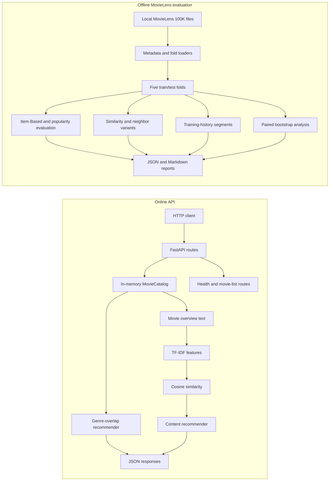

# Movie Recommender

> End-to-end recommendation microservice and reproducible offline evaluation framework comparing rating-based and content-based models on the MovieLens 100K benchmark.


Movie Recommender exposes real-time catalog recommendations via FastAPI and implements a deterministic offline evaluation suite on the MovieLens 100K benchmark.

The online API serves genre-overlap ranking and TF-IDF content similarity. The offline evaluation pipeline benchmarks Item-Based Collaborative Filtering (centered and uncentered), a training-set popularity baseline, neighbor-limit variants, user history-size segments, and per-fold paired bootstrap confidence intervals.

## Key features

- **Content-Based Filtering:** represent movie `overview` text with TF-IDF and rank candidates by cosine similarity.
- **Genre-based recommendations:** rank catalog movies by the number of genres shared with a reference movie.
- **Item-Based Collaborative Filtering:** build sparse user-item ratings and item-item cosine similarities from training ratings. User-mean-centered similarity is the reference model; an uncentered variant is evaluated separately.
- **Popularity baseline:** rank movies by their number of training-set ratings.
- **FastAPI:** serve the in-memory demonstration catalog and its recommendation endpoints.
- **Reproducible offline evaluation:** run the official five MovieLens folds, compare fixed variants, segment users by training-history size, and calculate per-fold paired bootstrap intervals.
- **Reports:** write structured results to JSON and a readable summary to Markdown.

## Architecture

The API and offline experiments are separate flows. The default API catalog contains three demonstration movies with example overviews. MovieLens metadata does not include synopses, and its loader leaves `overview` unset; the offline experiments use its ratings and genre metadata instead.



## Experimental results

The following values are the measured macro averages across the five MovieLens 100K folds in the generated experiment report (`reports/experiment_report.md`). `K=10` and test `ratings >= 4` define relevance. Coverage is the share of the 1,682-movie catalog.

| Model | Precision@10 | Recall@10 | NDCG@10 | Catalog coverage | Diversity | Novelty (bits) |
|---|---:|---:|---:|---:|---:|---:|
| Item-Based, centered | 0.1814 | 0.1401 | 0.2369 | 0.2880 | 0.7804 | 9.7353 |
| Item-Based, uncentered | 0.2448 | 0.2298 | 0.3355 | 0.1177 | 0.8080 | 8.3037 |
| Popularity baseline | 0.1532 | 0.1361 | 0.1982 | 0.0352 | 0.8363 | 7.8254 |

On this run, the uncentered variant achieved higher ranking metrics than the centered reference and popularity baseline, while the centered model achieved higher catalog coverage and novelty. The uncentered model had slightly higher diversity than the centered model. Popularity had the highest diversity but the lowest coverage, ranking metrics, and novelty among these three. Higher novelty means recommendations are less frequent in training ratings. These are benchmark-specific observations, not evidence of universal model superiority.

## Tech stack

- **Python 3.13** (`>=3.13,<3.14`)
- **FastAPI** and **Uvicorn** for the HTTP API
- **Pydantic 2** for data and response schemas
- **scikit-learn** for TF-IDF and cosine similarity; **SciPy** sparse matrices represent collaborative ratings (SciPy is installed as a scikit-learn dependency)
- **Pytest** for tests and **Ruff** for linting
- Python standard library for MovieLens file loading, experiment orchestration, bootstrap sampling, and report serialization

Development dependencies are declared in the `dev` optional dependency group in `pyproject.toml`.

## Dataset

The offline evaluations use [MovieLens 100K](https://grouplens.org/datasets/movielens/100k/). The dataset README describes 100,000 ratings from 943 users on 1,682 movies; each user has at least 20 ratings. Ratings use a 1–5 scale. The data was collected between 1997 and 1998. See the [official dataset README and usage terms](https://files.grouplens.org/datasets/movielens/ml-100k-README.txt) for field descriptions, citation instructions, and conditions of use.

The project uses `u.item` and `u.genre` for movie IDs, titles, and the 19 binary genre fields; `u.user` supplies the expected user IDs. The official `u1.base` and `u1.test` through `u5.base` and `u5.test` files provide five 80/20 train/test splits. Each fold has 80,000 training ratings and 20,000 test ratings. The experiment loader validates file structure, expected IDs, and train/test pair separation.

### Obtaining and preparing the data

Download `ml-100k.zip` from the official [MovieLens 100K page](https://grouplens.org/datasets/movielens/100k/) and extract it under `data/movielens/raw/`. The command below assumes the downloaded archive is in the repository root:

```bash
mkdir -p data/movielens/raw
unzip ml-100k.zip -d data/movielens/raw
```

The extracted files should be under `data/movielens/raw/ml-100k/`. The project does not download or extract the archive automatically. Raw and processed MovieLens data and the generated JSON results are ignored by Git. The Markdown experiment report is retained as a reviewable snapshot; the dataset is not included in this repository.

The official usage terms restrict redistribution without separate permission and commercial or revenue-bearing use without prior permission. They also require acknowledgement in publications and prohibit implying endorsement by GroupLens or the University of Minnesota. Do not commit or redistribute the dataset with this project. Follow the linked terms for any use beyond local evaluation.

## Installation and usage

Python 3.13 is required. From the repository root, create a virtual environment and install the application with its development tools:

```bash
python3.13 -m venv .venv
source .venv/bin/activate
python -m pip install --upgrade pip
python -m pip install -e ".[dev]"
```

Start the API:

```bash
uvicorn app.main:app --reload
```

The API is available at `http://127.0.0.1:8000`. Interactive OpenAPI documentation is at `http://127.0.0.1:8000/docs`.

Run the complete offline experiment suite after preparing the dataset:

```bash
python -m app.run_experiments
```

The default input directory is `data/movielens/raw/ml-100k/`. To use different paths, pass `--data-dir` and `--reports-dir`. The command reports missing files and instructions rather than downloading data. It writes `reports/experiment_results.json` and `reports/experiment_report.md`.

Run the tests and lint check from the repository root:

```bash
python -m pytest
python -m ruff check .
```

## Docker

The image runs the FastAPI application with its three-movie demonstration catalog. It does not include MovieLens data or generated reports and does not run the offline experiments.

Build the image from the repository root:

```bash
docker build -t movie-recommender:local .
```

Start the API and map container port 8000 to port 8000 on the host:

```bash
docker run --detach --name movie-recommender-api --publish 8000:8000 movie-recommender:local
```

Open the interactive API documentation at `http://127.0.0.1:8000/docs`. Stop the container when finished:

```bash
docker stop movie-recommender-api
```

## API demo script

After starting the API locally with Uvicorn or in Docker using the command above, run the demonstration script from the repository root:

```bash
./examples/api_demo.sh
```

The script checks health, lists the catalog, and requests genre-based and content-based recommendations for `arrival`. It uses `http://127.0.0.1:8000` and only sends requests; it does not start or stop the API. The same command works with the Docker container while its port is mapped to host port 8000.

## API

The default `create_app()` catalog contains `Arrival`, `Contact`, and `Amélie`. `Movie` records have `id`, `title`, `genres`, and optional `overview` fields. The API currently exposes:

| Method and path | Behavior | Responses |
|---|---|---|
| `GET /health` | Health check | `200` with `{"status":"ok"}` |
| `GET /movies` | List catalog movies | `200` with an array of movie records |
| `GET /movies/{movie_id}/recommendations` | Rank by shared genres | `200`; `404` for an unknown reference; `422` for an invalid `limit` |
| `GET /movies/{movie_id}/content-recommendations` | Rank by overview TF-IDF cosine similarity | `200`; `404` for an unknown reference; `422` for an invalid `limit` |

Both recommendation endpoints accept `limit` from 1 to 50, defaulting to 10. An unknown reference returns `{"detail":"Movie not found"}`. A valid reference with no candidates returns an empty `recommendations` array.

### Example requests and responses

Health check:

```bash
curl [http://127.0.0.1:8000/health](http://127.0.0.1:8000/health)
```

```json
{"status":"ok"}
```

List the demonstration catalog:

```bash
curl [http://127.0.0.1:8000/movies](http://127.0.0.1:8000/movies)
```

```json
[
  {
    "id": "arrival",
    "title": "Arrival",
    "genres": ["Drama", "Sci-Fi"],
    "overview": "Uma linguista tenta compreender a chegada de naves alienígenas."
  },
  {
    "id": "contact",
    "title": "Contact",
    "genres": ["Drama", "Sci-Fi"],
    "overview": "Uma astrônoma recebe um sinal que pode mudar a humanidade."
  },
  {
    "id": "amelie",
    "title": "Amélie",
    "genres": ["Comedy", "Romance"],
    "overview": "Uma jovem parisiense transforma a vida das pessoas ao seu redor."
  }
]
```

Genre-based recommendations for `Arrival`:

```bash
curl '[http://127.0.0.1:8000/movies/arrival/recommendations?limit=5](http://127.0.0.1:8000/movies/arrival/recommendations?limit=5)'
```

```json
{
  "movie_id": "arrival",
  "recommendations": [
    {
      "id": "contact",
      "title": "Contact",
      "genres": ["Drama", "Sci-Fi"],
      "overview": "Uma astrônoma recebe um sinal que pode mudar a humanidade.",
      "shared_genres_count": 2
    }
  ]
}
```

Content-based recommendations for `Arrival`:

```bash
curl '[http://127.0.0.1:8000/movies/arrival/content-recommendations?limit=5](http://127.0.0.1:8000/movies/arrival/content-recommendations?limit=5)'
```

```json
{
  "reference_movie_id": "arrival",
  "recommendations": [
    {
      "id": "contact",
      "title": "Contact",
      "genres": ["Drama", "Sci-Fi"],
      "overview": "Uma astrônoma recebe um sinal que pode mudar a humanidade.",
      "similarity_score": 0.04453370337490556
    },
    {
      "id": "amelie",
      "title": "Amélie",
      "genres": ["Comedy", "Romance"],
      "overview": "Uma jovem parisiense transforma a vida das pessoas ao seu redor.",
      "similarity_score": 0.04208457856607507
    }
  ]
}
```

These are responses from the current three-movie demonstration catalog. Content scores are computed from its overview text and are not MovieLens benchmark results.

## Evaluation methodology

### Models and data separation

For every official fold, the recommenders are built from that fold's `.base` ratings only. The `.test` ratings define relevance (`rating >= 4`) and are not used to build matrices, item similarities, or popularity counts. Recommendations exclude movies already rated by that user in the training fold. All 1,682 catalog movie IDs are retained, including movies without training ratings. Unrated test items are unknown labels, not negative feedback.

The reference Item-Based model subtracts each user's mean from observed training ratings before calculating cosine similarities between movie columns. For a candidate, it sums positive item similarities weighted by the user's original training ratings. The uncentered variant calculates cosine similarity directly from the original ratings and uses the same scoring rule. The popularity baseline ranks by the number of training ratings, breaking ties by ascending movie ID. Top-20, top-50, and top-100 positive-neighbor variants are also evaluated; they do not change the default model.

### Ranking and catalog metrics

- **Precision@10** is the fraction of the ten recommendation positions that are relevant. A short list keeps 10 as its denominator; precision includes users with no relevant test items.
- **Recall@10** is the fraction of a user's relevant test items found in the top 10. It is undefined for users with no relevant items; those users are excluded from Recall and NDCG aggregates rather than assigned zero.
- **NDCG@10** measures how highly relevant items are ranked, using binary gain and logarithmic rank discount. It is normalized against the ideal ranking.
- **Catalog coverage** is the number of distinct catalog movie IDs recommended across evaluated users divided by the full catalog size (1,682).
- **Intra-list diversity** uses genre-set Jaccard similarity. For each user it averages `1 - Jaccard` over comparable movie pairs, then macro-averages users with at least one comparable pair. Pairs involving a movie with no genres are omitted; no genres are inferred.
- **Novelty** is the mean self-information of generated recommendations, `-log2(item_rating_count / training_rating_count)`, with item counts derived from the training fold only. An item with no training ratings has probability zero and therefore mathematical novelty `+infinity`; no popularity is imputed. Novelty is undefined when there are no recommendations or no training ratings.

Per-fold metrics are macro-averaged with equal fold weight; results are not pooled as if the folds were independent. The official folds have disjoint test rating records, but users can occur in multiple folds.

### Segmented and paired analyses

The segmented evaluation classifies each test user by the number of ratings in that fold's training history: 1–5, 6–10, 11–20, or 21+. Test ratings do not determine the segment. Precision uses all users in a segment; Recall and NDCG omit users without relevant test items. Folds with no users in a segment have undefined metrics and are not replaced with zero.

The paired analysis compares uncentered minus centered per-user scores for the same user, training history, test relevance set, catalog, and K=10. It performs 10,000 bootstrap resamples with replacement per metric and fold, using seed 42 and a percentile 95% interval. Resampling is kept within each fold. Macro differences give equal weight to folds with eligible users. These intervals describe resampling stability in this benchmark; they are not, by themselves, proof of statistical significance or generalization.

## Limitations

### Dataset limitations

- MovieLens 100K contains historical ratings collected in 1997–1998. Its 943 users were selected to have at least 20 ratings, so the data does not represent cold-start users or a current movie audience.
- MovieLens metadata provides titles and genres but no synopses. The TF-IDF API recommender therefore uses the demonstration catalog or another catalog with supplied `overview` values; the MovieLens loader leaves `overview` unset.
- Ratings are explicit feedback, but the evaluation binarizes them at 4. The test fold only labels rated movies; unobserved items cannot safely be treated as dislikes.

### Implementation and evaluation scope

- The default API catalog is a three-movie demonstration. The offline collaborative and popularity evaluations are not exposed as API endpoints.
- Item-Based Collaborative Filtering is a sparse cosine model with a weighted rating score; it is not a latent-factor model and does not model user or item bias terms.
- Relevance threshold, K, and the tested neighbor limits are fixed in the current experiment protocol. This is a comparative offline study, not a production ranking service or online experiment.
- The five folds share users, and the dataset is small and dated. Results and bootstrap intervals should not be generalized to other datasets or populations without further evaluation.

## Project structure

```text
.
├── .dockerignore
├── .github/
│   └── workflows/
│       └── ci.yml
├── Dockerfile
├── app/
│   ├── main.py                     # FastAPI app and demo catalog
│   ├── routes.py                   # HTTP endpoints
│   ├── models.py                   # Pydantic movie and response schemas
│   ├── catalog.py                  # In-memory movie catalog
│   ├── recommender.py               # Genre-overlap ranking
│   ├── content_recommender.py       # TF-IDF similarity ranking
│   ├── text_features.py             # TF-IDF representation
│   ├── similarity.py                # Sparse cosine similarity
│   ├── movielens.py                # MovieLens metadata and rating loaders
│   ├── movielens_splits.py          # Official fold loader and validation
│   ├── collaborative_filtering.py   # Item-Based model and ranking
│   ├── collaborative_variants.py    # Uncentered and neighbor-limit variants
│   ├── popularity.py                # Rating-count baseline
│   ├── evaluation.py                # Precision, Recall, and NDCG
│   ├── analysis_metrics.py          # Coverage, diversity, and novelty
│   ├── experiments.py               # Core model and baseline evaluation
│   ├── variant_experiments.py       # Variant evaluation
│   ├── segmented_experiments.py     # Training-history segments
│   ├── paired_analysis.py           # Paired differences and bootstrap
│   └── run_experiments.py            # CLI orchestration and report generation
├── data/movielens/raw/ml-100k/       # Locally extracted, Git-ignored dataset
├── examples/
│   └── api_demo.sh                   # Requests against a running local API
├── reports/
│   ├── experiment_report.md          # Reviewable experiment snapshot
│   └── experiment_results.json       # Generated locally, Git-ignored
├── tests/                            # API, loader, metric, and experiment tests
└── pyproject.toml                    # Dependencies and tool configuration
```

## Reproducibility

From the repository root, run `python -m app.run_experiments` with the extracted official files. The command uses all five splits and the complete movie catalog, K=10, relevance threshold 4, and bootstrap seed 42 with 10,000 resamples per metric and fold. It builds models from training data only, does not download MovieLens, and writes the per-fold results and configuration to the JSON report. The reports are deterministic for the same input files and code/configuration. Raw data and generated JSON results are ignored by Git; the Markdown report is kept as a reviewable snapshot.
